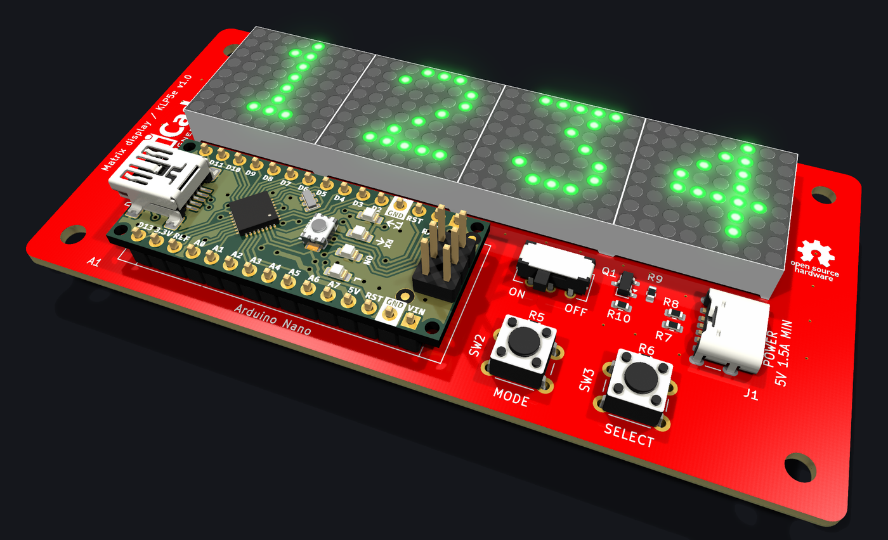

# klp5e-c2-m5-led-matrix stages



One folder per step of Module 5's warm-up board: four MAX7219 cells, each driving an 8 × 8 LED
matrix, on a 100 × 50 mm board, fed by an Arduino Nano. The module builds one cell, stamps it four
times in the schematic, and routes it once on the board before copying it to the other three. Each
stage is the project as it stood at the end of a lecture and the start of the next one.

**Every stage is a complete KiCad project.** Open the `.kicad_pro` in a stage folder and it loads
on its own: the schematic, the board, the `.kicad_dru` custom rules, the project's symbol,
footprint and design block library tables, and `Libraries/`, which holds the matrix, the Nano and
the logo footprints, the symbols, the `MAX7219-Cell` design block and the 3D models. Each stage
also holds `tools/checknet.py`, the netlist checker used in lecture 5.5. Copy a stage folder out of
the repository before you work in it, and do not open two stages at once.

| Stage | State | Produced by |
|---|---|---|
| `00-start` | The once-only parts (the Nano, USB-C input, the MOSFET power switch, the buttons and their resistors), power symbols and labels; no cell yet; the board outline and the fabricator's limits; no footprints on the board | bonus B5.1 |
| `01-first-cell` | The `POWER` net class; cell 1 drawn and wired, `DIN` and `DOUT` bare | lecture 5.3 |
| `02-cell-footprints` | The cell's five footprints assigned | bonus B5.2 |
| `03-four-cells` | The cell saved as the `MAX7219-Cell` design block and placed three more times; the cascade links drawn, **with one mislabelled link**: the mistake lecture 5.5 finds | lecture 5.4 |
| `04-netlist-clean` | The link label fixed; ERC clean; all five checknet runs pass | lecture 5.5 |
| `05-matrices-placed` | Footprints on the board as four groups; matrices `DS1` to `DS4` at 20 mm pitch, locked | lecture 5.6 |
| `06-once-only-placed` | The once-only parts and the four mounting holes placed; cells 2 to 4 roughly under their matrices | bonus B5.3 |
| `07-reference-started` | Cell 1 routed on the back | lecture 5.7 |
| `08-reference-routed` | The same board as `07`: cell 1, the reference cell, fully routed | lecture 5.7 |
| `09-repeated` | Groups renamed `DS1` to `DS4`, each with a placement rule area; cells 2 to 4 placed and routed from cell 1 by Repeat Layout | lecture 5.8 |
| `10-shared-wiring` | The wiring the cells share (power, clock, load and the cascade) drawn into and out of cells 1 and 2. The start of A5.1 | bonus B5.5 |
| `11-copied` | Cells 3 and 4 given their shared wiring by one Repeat Layout from cell 2, unrepaired. A5.1's worked solution | bonus B5.6 |
| `12-repaired` | The two stacked vias the copy left at the cell 3 and cell 4 seams removed; no DRC warnings, only `GND` unconnected | lecture 5.9 |
| `13-first-pour` | One `GND` zone on both layers, filled: much of the back's copper is cut away between the cells' tracks | lecture 5.10 |
| `14-stitched` | `DIN1` and the cascade links re-routed; `GND` vias stitched through the pour until every filled piece reaches one; nothing unconnected | bonus B5.7 |
| `15-finished` | Reference designators resized, the silkscreen labels and the board's name and version added, the Nano's 3D model placed: the finished board | bonus B5.8 |

Up to `12-repaired`, every stage leaves `GND` unconnected: the copper pour joins it in lecture
5.10, and the stitching vias in `14-stitched` finish the job. When you open `13-first-pour` or a
later stage, press B to refill the pour before you read it or run the DRC.

## Checking the netlist (lecture 5.5)

From a stage folder, from `03-four-cells` on:

```bash
kicad-cli sch export netlist -o net.net klp5e-c2-m5-led-matrix.kicad_sch
for n in 1 2 3 4; do python3 tools/checknet.py net.net --cell $n; done
python3 tools/checknet.py net.net --cascade 4
```

On `03-four-cells` the cascade run fails at the mislabelled link; on `04-netlist-clean` all five
runs pass.

## Activity A5.1

[`A5.1-activity/`](A5.1-activity/) has everything for the activity in its own README: where you
start, the steps, the acceptance list and where you finish. The folder also holds a record sheet
(`record-sheet.md`) and the lecture's slide deck (`slides.html`). Start from `10-shared-wiring`,
and compare your result with `11-copied` only after you have checked every line of the acceptance
list.
